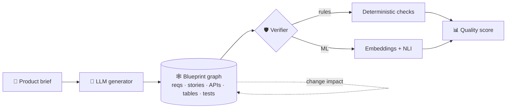

<p align="center">
  
</p>

<p align="center">
  <a href="https://github.com/sohumcs">
    
  </a>
</p>

<p align="center">
  <a href="https://www.linkedin.com/in/sohumcs/"></a>
  <a href="mailto:sohum611@gmail.com"></a>
  <a href="https://leetcode.com/sohumcs"></a>
  
</p>

<br/>

## `$ whoami`

```python
class Sohum:
    role       = "Backend & Cloud Engineer who ships AI features"
    education  = "B.Tech CSE (AI & ML) @ SRM IST · Class of 2027 · CGPA 9.34"

    shipped    = {
        "Network18":       "Python/SQL pipeline over 100M+ records → 35% lower query latency",
        "Outlier AI":      "LLM evaluation, adversarial prompting, RLHF data quality",
        "D-Town Robotics": "UAV telemetry automation → 50% less manual analysis",
    }

    certified  = ["AWS ML Engineer – Associate", "AWS Data Engineer – Associate",
                  "AWS AI Practitioner", "AWS Cloud Practitioner"]

    loves      = ["distributed backends", "infra as code", "LLMs that check their own work"]
    open_to    = "6-month SDE / Backend / Platform / GenAI internships · Jan 2027 · NCR or remote"
```

<br/>

## ⚡ Now building: **SPECForge v2**


An AI platform that turns a one-paragraph product brief into a **complete, connected software blueprint**: requirements, user stories, modules, REST APIs, DB entities, test cases and a risk register.

- 🧠 **Self-checking generation:** a rule engine plus sentence-embedding and NLI models catch duplicates and contradictions, then score every blueprint
- 🕸️ **Graph, not a document:** change one requirement and the impact propagates to every linked story, API, table and test
- 🚀 **Production-grade:** FastAPI · Celery/Redis · Postgres + pgvector · Docker · Kubernetes · Terraform · GitHub Actions · AWS

<br clear="right"/>



<br/>

## 🧪 Things I've built

<table>
  <tr>
    <td width="50%" valign="top">
      <h3>🛰️ VARI UAV Crop-Health App</h3>
      Offline Android app that computes crop-health indices from drone imagery with on-device TensorFlow inference.<br/><br/>
      <code>Kotlin</code> <code>TensorFlow</code> <code>OpenCV</code>
    </td>
    <td width="50%" valign="top">
      <h3>🎮 RL Tactical Simulation</h3>
      Multi-agent tactical game comparing Q-learning agent strategies, with CSV analytics and performance graphs.<br/><br/>
      <code>Python</code> <code>Q-learning</code> <code>Pygame</code>
    </td>
  </tr>
  <tr>
    <td width="50%" valign="top">
      <h3>🏫 AFS Training Academy</h3>
      Production web app shipped for a real client; cut page load time by 30%.<br/><br/>
      <code>React</code> <code>Flask</code> <code>REST</code>
    </td>
    <td width="50%" valign="top">
      <h3>🖱️ Auto-Clicker</h3>
      Open-source, cross-platform multithreaded utility. I triage issues and review community PRs.<br/><br/>
      <code>Python</code> <code>Multithreading</code>
    </td>
  </tr>
</table>

<br/>

## 🛠️ Toolbox

<p align="center">
  <b>Languages</b><br/><br/>
  
  <br/><br/>
  <b>Backend & Data</b><br/><br/>
  
  <br/><br/>
  <b>Cloud & DevOps</b><br/><br/>
  
  <br/><br/>
  <b>AI / ML</b><br/><br/>
  
</p>

<br/>

## 📈 Activity

<p align="center">
  
  
</p>

<p align="center">
  
</p>

<p align="center">
  <picture>
    <source media="(prefers-color-scheme: dark)" srcset="https://raw.githubusercontent.com/sohumcs/sohumcs/output/github-snake-dark.svg" />
    
  </picture>
</p>


